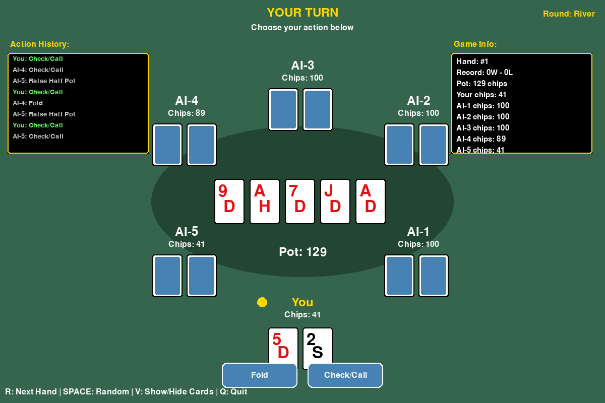
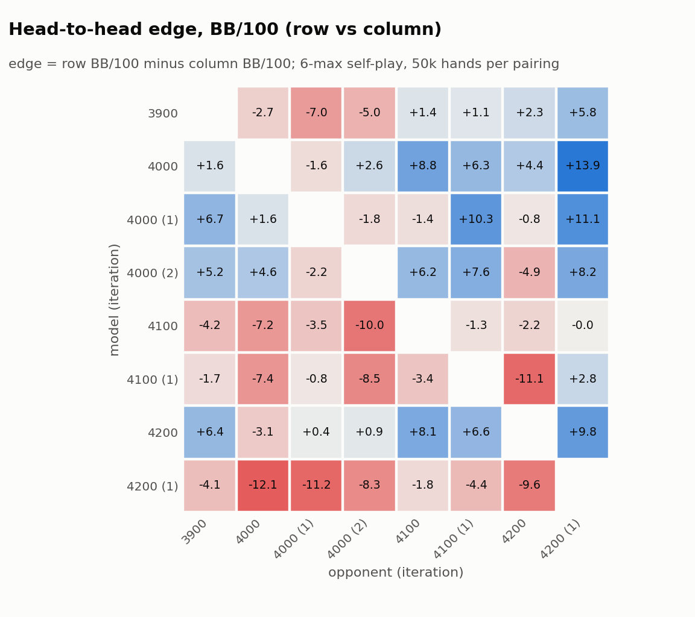
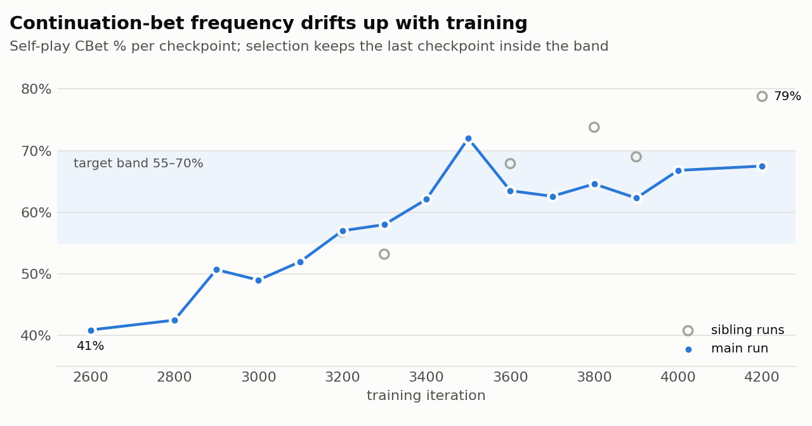

# deep-cfr-holdem

[](https://github.com/dimidjy/deep-cfr-holdem/actions/workflows/tests.yml)


[](https://github.com/dimidjy/deep-cfr-holdem/releases)
[](LICENSE)

Deep CFR, offline reinforcement learning and self-play evaluation for
**6-max No-Limit Texas Hold'em**.

Research code for training and evaluating agents for **6-max No-Limit Texas
Hold'em**, an imperfect-information, multi-agent game. It covers the whole
loop: a fast game engine, Deep CFR self-play training on GPU, offline RL from
hand-history data, a staged decision pipeline, and an evaluation harness
(self-play statistics, head-to-head tournaments, GTO solver checks).

Built March–August 2026 as a personal research project, about 57k lines of
Python.

## Highlights

- **Deep CFR on GPU.** External-sampling MCCFR traversals run in
  multiprocess workers. The networks are residual advantage and strategy
  nets, the buffers are reservoir-sampled, and training resumes from
  checkpoints. Reward shaping (bluff/value/draw-aware bonuses) is all
  config-driven. See `scripts/train_gpu.py` and `src/training/`.
- **Self-play against a K-best opponent pool.** Burst-loop training keeps a
  diverse pool of past checkpoints across the aggression axis, so the trainee
  does not overfit to a single opponent style (`scripts/train_burst_loop.py`).
- **Offline RL and imitation.** Supervised policy, CQL and IQL trainers learn
  from parsed hand histories, with cohort filtering, counterfactual folds
  and reward weighting (`scripts/train_supervised.py`, `train_cql.py`,
  `train_iql.py`). Imitation on annotated spots can be mixed into CFR
  training.
- **Fast engine.** A NumPy engine with 53-dim observations: position, pot
  odds, hand strength, equity, board texture, betting line and behavioral
  stats. A neural equity model replaces Monte Carlo equity in the hot path
  (`src/engine/`, `scripts/train_equity_model.py`).
- **One observation schema.** Three code paths build observations: the
  training engine, the hand-history generator and the runtime agent.
  `src/obs_schema.py` owns the layout and `tests/test_obs_parity.py`
  enforces that all three agree. See *Lessons learned* for why.
- **Staged decision pipeline.** Model strategy, then conditional overrides,
  then data-driven sizing, as an ordered list of small stages
  (`src/agent/decision_pipeline.py`). Self-play and spot evaluation run the
  same pipeline.
- **Evaluation harness.** Self-play GTO-band statistics (VPIP, PFR, CBet, AF,
  WTSD), a parallel round-robin tournament with resumable jobs, validation
  against hand histories and the public Pluribus logs, and a TexasSolver
  bridge for GTO spot checks (`scripts/tournament.py`,
  `scripts/analysis/self_play.py`, `src/gto/`).
- **Tooling.** A FastAPI web UI to launch jobs, stream metrics and explore
  model decisions spot by spot, plus a parametric spot library and
  LLM-assisted spot labeling.

<p align="center"></p>

## Repository layout

```
src/
  engine/          fast game engine + enhanced observation features
  training/        Deep CFR (networks, buffers, batched traversal)
  agent/           game-state model, runtime observation builder, decision pipeline
  models/          unified adapters for Deep CFR / CQL / supervised checkpoints
  hand_history/    hand-history parser and observation builder
  gto/             TexasSolver bridge (spot inputs, range builder, extraction)
  search/          depth-limited and Monte Carlo rollout search
  decision_engine.py, preflop_*.py, postflop_*.py   lookups and sizing
  obs_schema.py    single source of truth for the observation layout
scripts/           training, data building, evaluation and analysis CLIs
tests/             355 tests (engine, CFR utils, lookups, obs parity, GTO)
webui/             job runner and spot explorer
configs/           training configs and preflop range tables
```

Details are in [docs/ARCHITECTURE.md](docs/ARCHITECTURE.md) and
[docs/TRAINING.md](docs/TRAINING.md).

## Quick start

```bash
pip install -r requirements.txt
make test                      # 355 tests, ~20 s on CPU

make models                    # download the published checkpoint + equity model
make selfplay HANDS=10000      # self-play stats for models/best/checkpoint_iter_4000.pt
make gui                       # play against it
make webui                     # job runner + spot explorer on http://127.0.0.1:8000

# train your own
make equity                    # neural equity model (generates its own data)
make train                     # Deep CFR on GPU (configs/training_config.json)
make tournament                # round-robin over a directory of checkpoints
```

`configs/training_config.json` is sized for a many-core server (10M-entry
buffers, 64k batches). On a workstation, lower `buffer_size`, `batch_size`
and `traversals_per_iteration`. Network updates start once the buffer
holds 40 batches.

### What is not in the repository

Large or third-party artifacts are gitignored. The core loop (equity model →
Deep CFR → self-play → tournament → web UI → GUI) needs none of them and runs
from a fresh clone.

| Artifact | Needed by | How to get it |
|---|---|---|
| `models/equity_model_v3.pt` | `make train`, spot evaluator | `make models` (download) or `make equity` |
| checkpoints in `models/` | self-play, tournament, GUI | `make models` (download `iter_4000`) or `make train` |
| hand-history archive in `data/poker_archive/` (6-max NLHE text histories) | supervised / CQL / IQL training, HH validation, lookup DBs | your own dataset |
| `data/preflop_lookup.sqlite`, `data/postflop_sizing.sqlite` | data-driven preflop/sizing stages (otherwise static ranges and preset sizes) | `scripts/build_preflop_lookup.py`, `scripts/build_postflop_lookup.py` |
| labeled spot JSONs in `logs/action_debug/` | imitation term in training, tournament spot phase | your own spots, labeled with `scripts/annotate_spots_with_claude.py` (`ANTHROPIC_API_KEY`) |
| TexasSolver binary | GTO spot validation | `bash scripts/setup_texassolver.sh` |

## Results

### Checkpoint tournament

Eight late-stage checkpoints from one training arc. Each model played every
other model head-to-head for 50k hands, plus 100k hands of hand-history
validation (`tournament/tornament_v34/summary.md`):

<picture>
  <source media="(prefers-color-scheme: dark)" srcset="docs/figures/h2h-dark.png">
  
</picture>

| Model | Spot % | H2H edge (BB/100) | W-T-L | CBet | AF | WTSD |
|---|---:|---:|:---:|---:|---:|---:|
| iter_4000 | 89.9 | **+4.45** | 8-5-1 | 61.5 | 2.26 | 32.0 |
| iter_4000 (2) | 88.0 | +3.91 | 9-4-1 | 62.8 | 2.31 | 32.4 |
| iter_4200 | 90.8 | +3.64 | 7-5-2 | 68.4 | 2.47 | 31.2 |
| iter_3900 | 85.3 | −1.00 | 3-6-5 | 58.9 | 2.79 | 30.2 |
| iter_4100 | 90.4 | −3.31 | 1-6-7 | 62.7 | 2.34 | 32.1 |

The selected checkpoint (`iter_4000`) has the best average head-to-head
edge and sits inside all three postflop target bands used for model
selection (CBet 55–70%, AF 2.0–3.5, WTSD 25–32%).

## Lessons learned

- **Train/serve skew is the expensive bug.** Equity at `obs[18]` was
  computed heads-up in training but multiway at runtime, so a 6-way top pair
  read 0.70 in one and 0.19 in the other. The fix was structural: one
  schema module, and a parity test that compares all three builders on
  the same states.
- **Head-to-head wins can mislead.** Training drifts toward
  over-aggression. CBet climbs from 41% at iteration 2600 to 72% at 3500
  on the main run, and sibling runs reach 79%. Aggressive checkpoints beat
  passive siblings in self-play but are exploitable, so model selection
  requires self-play statistics inside the target bands *before* looking at
  head-to-head edge
  ([`docs/results/training_drift.csv`](docs/results/training_drift.csv)):

  <picture>
    <source media="(prefers-color-scheme: dark)" srcset="docs/figures/drift-dark.png">
    
  </picture>

- **Shaping needs controlled A/B tests.** Several reward shapers looked good
  in isolation and were reverted after tournament comparison. Keeping them
  as config flags (default off) made that cheap.

## Known limitations

- **Hand-crafted spots expose leaks.** On synthetic spots from the spot
  library, the raw network folds some very strong hands (trips on a paired
  board) to small bets. Self-play and tournament play don't surface this.
  It is the kind of gap the spot library and web UI were built to find, and
  the next step is targeted imitation data for those spots.
- **No exploitability measurement.** Exact best response is intractable
  for 6-max NLHE. Evaluation relies on self-play statistics, tournaments
  and fixed opponents rather than LBR or a learned best response.
- **Hand-history data is not included.** The offline-RL components were
  trained on a private archive of 6-max NLHE hand histories that is not
  distributed. To reproduce, supply your own histories in the standard
  text format, or use the public Pluribus logs
  (`scripts/analysis/validate_vs_pluribus.py`).

## References

- N. Brown, A. Lerer, S. Gross, T. Sandholm. *Deep Counterfactual Regret
  Minimization.* ICML 2019. [arXiv:1811.00164](https://arxiv.org/abs/1811.00164)
- M. Lanctot et al. *Monte Carlo Sampling for Regret Minimization in
  Extensive Games.* NeurIPS 2009 (external-sampling MCCFR).
- N. Brown, T. Sandholm. *Superhuman AI for multiplayer poker* (Pluribus).
  Science 2019.
- A. Kumar et al. *Conservative Q-Learning for Offline Reinforcement
  Learning.* NeurIPS 2020. [arXiv:2006.04779](https://arxiv.org/abs/2006.04779)
- I. Kostrikov, A. Nair, S. Levine. *Offline Reinforcement Learning with
  Implicit Q-Learning.* ICLR 2022. [arXiv:2110.06169](https://arxiv.org/abs/2110.06169)
- V. Lisý, M. Bowling. *Equilibrium Approximation Quality of Current
  No-Limit Poker Bots.* 2017 (local best response).
  [arXiv:1612.07547](https://arxiv.org/abs/1612.07547)

## Related projects

- [OpenSpiel](https://github.com/google-deepmind/open_spiel): games and
  algorithms for RL research, including CFR variants
- [RLCard](https://github.com/datamllab/rlcard): RL toolkit for card games
- [PokerKit](https://github.com/uoftcprg/pokerkit): poker simulation and
  hand evaluation library
- [TexasSolver](https://github.com/bupticybee/TexasSolver): open-source GTO
  solver used for spot validation here

## Scope

This repository is a game-AI and reinforcement-learning research project.
It contains no code for connecting to, reading from or acting on any online
poker platform.

## Citation

If this code is useful in your work, see [`CITATION.cff`](CITATION.cff).

## License

MIT
